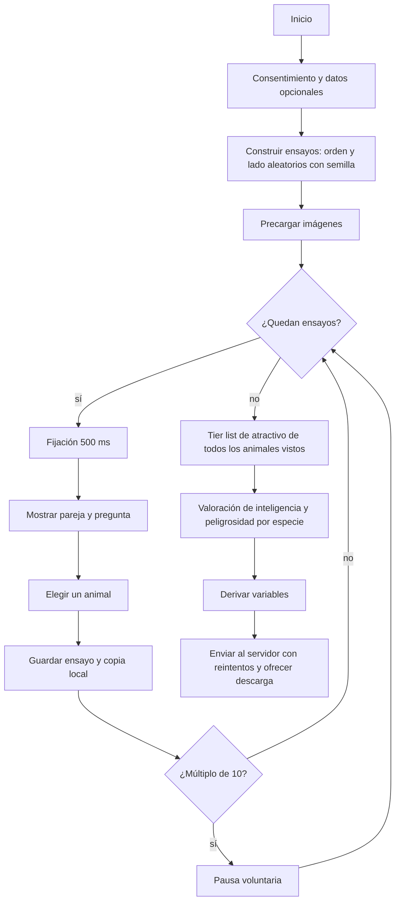

# Protocolo experimental: atractivo estético y ayuda a animales

**Versión del software:** 1.0.0 · **Archivo de configuración:** `js/config.js`

## 1. Objetivo e hipótesis

Determinar si, al decidir a qué animal ayudar, las personas se guían solo por la necesidad o también por el atractivo estético del animal.

- **H1.** Entre dos animales con necesidad equivalente, los participantes elegirán ayudar al que perciben como más atractivo.
- **H2.** Esa preferencia variará según las especies comparadas y otros factores, como la inteligencia percibida y la peligrosidad percibida.

## 2. Del papel al formato digital

La versión de referencia en papel consiste en: (a) un cuadernillo con una pareja de fotografías por página, (b) una hoja de respuestas donde se marca A o B, (c) un juego de tarjetas con los animales que el participante ordena en columnas rotuladas de «muy bonito» a «nada bonito», y (d) un cuestionario impreso de valoración por especie. La tabla muestra cómo se traspuso cada elemento y qué amenaza a la validez se evita o se introduce.

| Elemento en papel | Equivalente digital | Efecto sobre la validez |
|---|---|---|
| Cuadernillo con orden fijo | Orden aleatorio de parejas por participante (semilla guardada) | Elimina el sesgo de orden |
| Posición izquierda/derecha fijada por el investigador | Lado contrabalanceado: la mitad de las parejas con A a la izquierda | Elimina el sesgo de posición |
| Pasar de página a ritmo propio | Pantalla de fijación de 500 ms entre ensayos | Evita arrastre de la respuesta anterior |
| Marcar con lápiz | Clic o flechas ← →, ignorando respuestas antes de 300 ms | Evita clics accidentales |
| Sin medición de tiempo | Tiempo de respuesta en ms, medido tras pintar los estímulos | Dato nuevo (no existía en papel) |
| Tarjetas ordenadas sobre la mesa | Tier list con arrastrar o tocar; el grupo inicial se baraja | Evita sesgo por orden inicial |
| Casillas con valor marcado de antemano | Escala 1–7 sin valor por defecto, obligatoria | Evita confundir «no respondió» con un valor medio |
| Registro manual de resultados | Registro automático y exportación JSON/CSV | Elimina errores de transcripción |

**Diferencias que no pueden eliminarse:** el tamaño y la calibración de la pantalla varían entre participantes, por lo que se registran `pantalla` y `dpr`, y el entorno no está controlado como en una sala de laboratorio.

## 3. Variables

| Variable | Rol | Tipo y rango | Origen |
|---|---|---|---|
| `elegido`, `rechazado` | Dependiente (H1, H2) | id de animal | Clic o tecla del participante |
| `elige_mas_bonito` | Dependiente derivada | 1 = eligió el de mayor atractivo, 0 = el de menor, vacío = empate | Cálculo con la tier list |
| `rt_ms` | Dependiente secundaria | Entero ≥ 300 (ms) | `performance.now()` |
| `belleza_elegido`, `belleza_rechazado` | Independiente (H1) | 1–5 (D=1 … S=5) | Tier list |
| `dif_belleza` | Descriptiva | −4 a 4 (elegido − rechazado) | Cálculo |
| `especie_elegida`, `especie_rechazada` | Independiente (H2) | Categórica | Configuración |
| `inteligencia_*`, `peligrosidad_*` | Moderadoras (H2) | 1–7 | Valoración por especie |
| `d_belleza_izq_der`, `d_inteligencia_izq_der`, `d_peligrosidad_izq_der` | Predictores derivados (H2) | Diferencia izquierda − derecha; no dependen de la elección | Cálculo |
| `lado`, `elige_izquierda` | Control | izquierda/derecha; 0/1 | Diseño |
| `orden`, `parejaId` | Control | Entero | Diseño |
| `edad`, `genero`, `mascota` | Covariables (opcionales) | Número / texto | Formulario inicial |

## 4. Procedimiento y flujo



El participante ve primero todas las elecciones y solo después valora el atractivo. Así la tier list no puede influir en las decisiones, que es lo que mide H1.

## 5. Instrucciones al participante

Texto de la pantalla inicial: *«Verás parejas de animales que necesitan ayuda. En cada una, elige a cuál ayudarías: haz clic en la imagen o usa las flechas del teclado. Al final ordenarás los animales según lo bonitos que te parezcan y valorarás cada especie. Dura unos 5 minutos. No hay respuestas correctas ni incorrectas.»*

Pregunta de cada ensayo: *«Si solo pudieras ayudar a uno de estos animales, ¿a cuál elegirías?»*

## 6. Control de sesgos y validez

| Amenaza | Medida |
|---|---|
| Orden de presentación | Aleatorizado por participante |
| Posición en pantalla | Lado contrabalanceado; `elige_izquierda` permite verificarlo |
| Tiempos imprecisos | Carga previa de imágenes y medición tras el pintado de pantalla |
| Respuestas accidentales | Bloqueo de 300 ms y pantalla de fijación |
| Fatiga | Barra de progreso, pausa cada 10 ensayos, duración corta |
| Respuestas por defecto | Sin valores preseleccionados en las escalas |
| Orden inicial de la tier list | Barajado |
| Pérdida de datos | Copia local tras cada ensayo, reintentos de envío y descarga manual |
| Reproducibilidad | La semilla de cada participante se guarda en el resultado |
| Estímulos no equivalentes | Lista de verificación (sección 7) |

**Limitaciones conocidas:** (1) el atractivo se mide después de elegir, y una persona podría justificar su elección al ordenar; para controlarlo se puede aleatorizar entre participantes si la tier list va antes o después. (2) La muestra en línea no es aleatoria. (3) La situación mostrada es el único control de la necesidad del animal, por lo que la equivalencia de las fotos es crítica.

## 7. Equivalencia de estímulos (lista de verificación del investigador)

Antes de publicar cada pareja confirma que ambas imágenes: muestran el mismo tipo de necesidad (por ejemplo, herida visible en una pata), tienen una gravedad evaluada como equivalente por al menos dos jueces independientes, tienen las mismas posibilidades de recuperación, comparten encuadre, tamaño, iluminación y resolución, y no incluyen personas, texto ni marcas visibles. Se recomienda un estudio piloto con 5–10 personas para detectar parejas donde uno de los animales parezca más grave.

## 8. Arquitectura

| Módulo | Responsabilidad | Depende de |
|---|---|---|
| `js/config.js` | Parámetros, estímulos y parejas | nada |
| `js/estimulos.js` | Aleatorización, contrabalanceo, validación y precarga | `config` |
| `js/registro.js` | Acumula los datos de la sesión | `config` |
| `js/analisis.js` | Variables derivadas y CSV (funciones puras) | `config`, `estimulos` |
| `js/almacenamiento.js` | Guardado local, envío con reintentos, descarga | nada |
| `js/vistas/*.js` | Presentación de cada pantalla y captura de respuesta | `config`, `estimulos` |
| `js/main.js` | Secuencia del experimento (máquina de estados) | todos |

Cada vista devuelve una promesa con su resultado, por lo que `main.js` se lee como el procedimiento del experimento. Para cambiar el almacenamiento (por ejemplo, a Supabase) solo se modifica `almacenamiento.js`. Para agregar una tarea nueva se crea una vista y se agrega una línea en `main.js`.

## 9. Formato de salida

Un archivo JSON por participante. Ejemplo reducido:

```json
{
  "version": "1.0.0",
  "participante": "b1c5…",
  "seed": 2837461,
  "inicio": "2026-11-05T14:02:11.000Z",
  "fin": "2026-11-05T14:07:40.000Z",
  "completo": true,
  "perfil": {"edad": "24", "genero": "Femenino", "mascota": "Sí"},
  "entorno": {"userAgent": "…", "pantalla": [1280, 720], "dpr": 2, "tactil": false, "idioma": "es-CL"},
  "ensayos": [
    {"orden": 1, "parejaId": 6, "izquierda": "rata", "derecha": "panda", "elegido": "panda",
     "rechazado": "rata", "lado": "derecha", "rt_ms": 1420, "elige_izquierda": 0,
     "belleza_elegido": 5, "belleza_rechazado": 2, "dif_belleza": 3, "elige_mas_bonito": 1}
  ],
  "tiers": {"panda": "S", "rata": "C"},
  "valoraciones": {"panda": {"inteligencia": 4, "peligrosidad": 1}}
}
```

El CSV tiene una fila por ensayo con las columnas: `participante, orden, parejaId, izquierda, derecha, elegido, rechazado, lado, elige_izquierda, rt_ms, especie_elegida, especie_rechazada, belleza_elegido, belleza_rechazado, dif_belleza, elige_mas_bonito, inteligencia_elegida, inteligencia_rechazada, peligrosidad_elegida, peligrosidad_rechazada, d_belleza_izq_der, d_inteligencia_izq_der, d_peligrosidad_izq_der, edad, genero, mascota`.

Una sesión abandonada queda en `localStorage` con `"completo": false`.

## 10. Guía de uso

**Ejecutar localmente.** Los módulos ES requieren un servidor. En la carpeta del proyecto: `python3 -m http.server 8000` y abrir `http://localhost:8000` (alternativa: extensión Live Server de VS Code).

**Configurar.** Edita solo `js/config.js`: agrega cada animal en `ANIMALES` con su foto en `img` (por ejemplo `img/panda.jpg`), define las parejas en `PAREJAS` (20–30) y ajusta `pausaCada`, `bloqueoMs` e `itiMs` si lo necesitas. Al iniciar, el programa comprueba que todas las parejas referencien animales existentes.

**Recolectar datos de varios participantes.** Publica la carpeta en un hosting estático (GitHub Pages, Netlify) y define `endpoint`. Con Google Apps Script (hoja de cálculo → Extensiones → Apps Script → implementar como aplicación web con acceso «cualquier persona»):

```javascript
function doPost(e) {
  const d = JSON.parse(e.postData.contents);
  SpreadsheetApp.getActiveSpreadsheet().getActiveSheet()
    .appendRow([d.participante, d.version, d.fin, JSON.stringify(d)]);
  return ContentService.createTextOutput("ok");
}
```

Cada fila contiene el JSON completo del participante, que luego se puede procesar en R o Python.

**Prueba antes de recolectar.** Completa la sesión tú mismo y comprueba que el CSV descargado tenga una fila por ensayo y que no haya columnas vacías, salvo `elige_mas_bonito` en empates.

## 11. Análisis sugerido

- **H1:** entre los ensayos sin empate, comparar la proporción de `elige_mas_bonito = 1` con 0,5 (prueba binomial) o ajustar un modelo logístico mixto: `elige_mas_bonito ~ 1 + (1 | participante) + (1 | parejaId)`; el intercepto positivo respalda H1.
- **H2:** modelo logístico mixto: `elige_izquierda ~ d_belleza_izq_der + d_inteligencia_izq_der + d_peligrosidad_izq_der + (1 | participante) + (1 | parejaId)`. Las diferencias se calculan por posición (izquierda − derecha) y no a partir de la elección, así que no hay circularidad. Un coeficiente de `d_belleza_izq_der` que cambie al incluir las otras dos indica que inteligencia o peligrosidad modulan el efecto del atractivo. También puede analizarse la proporción `elige_mas_bonito` por pareja de especies.

## 12. Control de versiones

Se recomienda un repositorio Git con una rama por cambio. Cada cambio en estímulos, diseño o formato de datos sube la versión (`VERSION`, `js/config.js`) y se anota en `CHANGELOG.md`. Los archivos de resultados guardan `version`, por lo que siempre se sabe con qué configuración se obtuvo cada dato.
